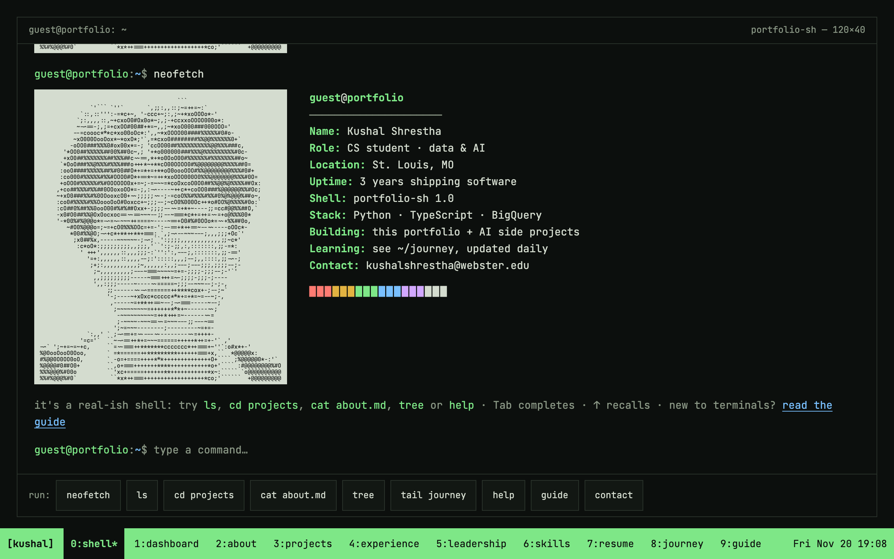

# Kushal Shrestha's terminal portfolio

A portfolio that behaves like a terminal. The home page is a working fake shell (`portfolio-sh`) with `ls`, `cd`, `cat`, `neofetch`, Tab completion and history; every other page is styled as a terminal program (a man page, `git log`, `ps aux`, `apt list`, a TUI dashboard); and a tmux-style bar links them all, so nobody ever _has_ to type. It is fully static, fast, accessible, and the whole site is one filesystem: every project, job, skill and daily journey entry has its own page, and `cd projects` really navigates there.



**Live site:** `TODO` (set at deploy time; also set `NEXT_PUBLIC_SITE_URL`, see below)

## Stack, and why

- **Next.js (App Router) with `output: 'export'`.** No server at runtime: every route is pre-rendered to HTML in `out/`, so it deploys to any static host.
- **Server Components by default, small client islands.** Pages are server-rendered from `content/`. Only the nav bar, the docked command line, the shell, the dashboard and a few widgets are client code.
- **A pure shell engine.** `lib/shell/` has no React in it: `exec(input, state, ctx)` returns lines and, when asked to, a navigation. It is unit-tested on its own.
- **Tailwind CSS v4** with the design tokens defined once in `app/globals.css`, **TypeScript** in strict mode, **Vitest** for logic, **Playwright + axe** for browsers.
- Few runtime dependencies: `remark` (Markdown write-ups), `gray-matter` (frontmatter) and `zod` (content validation). No UI kit, icon pack or animation library.

## Architecture

```
app/            routes (one folder per page; detail pages use generateStaticParams)
components/     terminal/ shell/ dashboard/ journey/ detail/ skills/ guide/ notfound/ seo/
content/        every fact, once: *.ts, write-ups in */*.md, journey/*.md, github.json
lib/            pure logic: site-tree, shell engine, journey math, SEO copy, hooks
scripts/        CLI helpers (journey:new, content:todos, github:sync, screenshot)
tests/          unit/ (Vitest) and e2e/ (Playwright, with visual baselines)
assets/fonts/   JetBrains Mono (OFL), read at build time for the social images
```

### How the shell works

- **The site tree is the single map.** `lib/site-tree.ts` builds one tree from content. The shell's filesystem, `generateStaticParams`, `cd`/`open`, the sitemap and the 404 suggestions all derive from it. There is no hand-written list of pages.
- **The engine is pure and returns navigations.** `cd projects` does not touch the router; `exec` returns `{ lines, cwd, navigate: '/projects/' }` and the UI performs the navigation.
- **One session store.** History, scrollback and the working directory live in a small shared store (persisted to `sessionStorage`), so the shell on `/` and the docked command line on every other page are the same session.
- **The dock loads lazily.** The docked command line ships only its input and panel UI. The engine and `fs.json` (the filesystem, a static file generated at build time) load on first interaction.
- **The URL is the working directory.** The shell's cwd always matches the page you are on; navigating with the nav bar or the back button updates it.

A few commands are not listed in `help`. Tab finds them.

## Commands

| Command              | What it does                                                                                                              |
| -------------------- | ------------------------------------------------------------------------------------------------------------------------- |
| `pnpm dev`           | Dev server                                                                                                                |
| `pnpm check`         | Lint, typecheck, unit tests and a production build. Run before every commit                                               |
| `pnpm test:e2e`      | Playwright: builds and serves `out/` (and a second build with fake journey data), then runs every project                 |
| `pnpm journey:new`   | Creates today's journey entry from the template                                                                           |
| `pnpm journey:check` | Validates every journey entry and prints the streak                                                                       |
| `pnpm content:todos` | Lists every `Todo` placeholder, unreviewed write-up and open `TODO(kushal)` question                                      |
| `pnpm github:sync`   | Refreshes the repo count and star counts in `content/github.json` from the public GitHub API. Never runs during the build |
| `pnpm screenshot`    | Rewrites `docs/screenshot.png` (needs `pnpm build && pnpm serve` running)                                                 |

Set `NEXT_PUBLIC_SITE_URL` (for example `https://kushal.dev`) when building for production: canonical URLs, the sitemap, `robots.txt` and the social-image URLs are absolute and use it. On Vercel without it, the build falls back to the project's production domain.

## CI/CD

`.github/workflows/ci.yml` runs on every push to `main` and every pull request:

1. **Check:** lint, typecheck, unit tests and a production build (`pnpm check`).
2. **Browser tests:** the Playwright suite in Chromium and WebKit. The screenshot comparisons are skipped on CI because their baselines are rendered on macOS; run `pnpm test:e2e` locally before merging a visual change.
3. **Deploy**, only when both pass: production for `main`, a preview for pull requests. Vercel's own Git auto-deploy is off (`vercel.json`), so nothing reaches the live site without passing the tests.

`.github/workflows/journey.yml` publishes branches that only add journey entries (from a Claude Code cloud session) straight to `main` after validating them, then starts CI/CD.

One-time setup, in the repo's **Settings → Secrets and variables → Actions**: `VERCEL_TOKEN` (vercel.com → Account Settings → Tokens), and `VERCEL_ORG_ID` and `VERCEL_PROJECT_ID` (from `.vercel/project.json` after running `vercel link` in the repo). Set `NEXT_PUBLIC_SITE_URL` in the Vercel project's environment variables if the site has a custom domain.

## Posting a journey entry

Tell the **Kushal's Portfolio** project in the Claude desktop app what you learned, built and want to do next. With this repo's folder connected, it saves `content/journey/<date>.md`; the journey auto-publisher (`pnpm journey:autopublish:install`, a launchd agent) validates it, commits only that file to `main` and pushes; CI/CD tests and deploys. Claude Code (the `journey` skill, plus `.github/workflows/journey.yml` for cloud sessions) and the terminal also work. Details are in [`content/journey/README.md`](content/journey/README.md).

## Accessibility and performance

- axe (WCAG 2.2 AA) runs on every route in desktop, reduced-motion, Pixel 7, iPhone 13 (WebKit), 320px, tablet, 1024px and 1920px projects. Touch targets are 44px, contrast is at least 4.5:1, the skip link is the first Tab stop, and forced colors and reduced motion are tested.
- Lighthouse on `/`, `/projects/`, `/projects/zenith/`, `/skills/python/`, `/resume/` and `/journey/`, mobile and desktop: 97-100 in Performance and 100 in Accessibility, Best Practices and SEO. Layout shift is about zero; typed text reserves its final layout.
- Content pages ship the framework plus the nav and dock islands (about 185 KB gzipped in total, of which the islands are about 12 KB). The dock's engine and filesystem (`fs.json`, about 6 KB gzipped) load on first use.
- Typing stays under 50 ms per keystroke after 200 commands of scrollback.
- Every page prints cleanly: black on white, no chrome, URLs after external links.
- Visual baselines are committed (`tests/e2e/__screenshots__`). They depend on font rendering, so regenerate them with `--update-snapshots` if you run the visual projects on another OS.

## Credits

[JetBrains Mono](https://www.jetbrains.com/lp/mono/) by JetBrains, licensed under the SIL Open Font License 1.1 (see `assets/fonts/OFL.txt`). The box-drawing, block and arrow glyphs are not in Google's subsets, so `app/fonts/` holds the same font cut to just those glyphs (3 KB per weight, OFL alongside); without it every diagram would fall back to a different system font on each OS.
